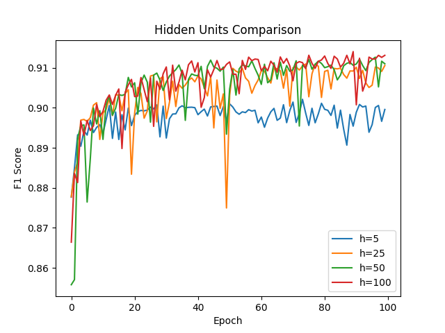
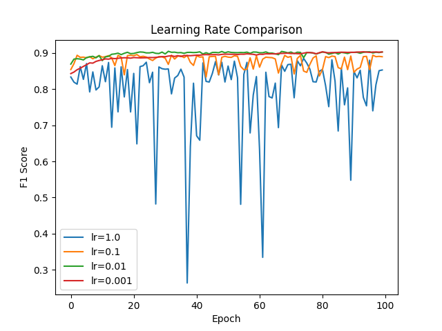
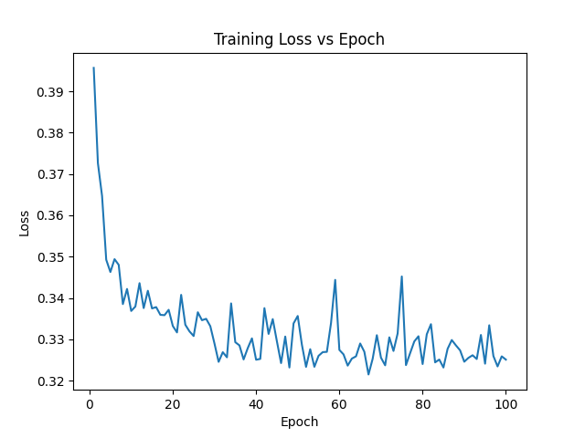
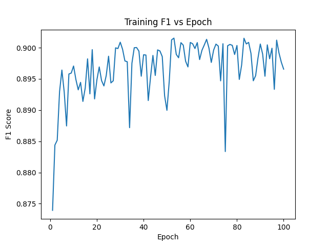

# Multi-Layer Perceptron Neural Network

## Project Overview

Implemented a Multi-Layer Perceptron (MLP) neural network from scratch using Python and NumPy to perform binary classification on the MAGIC Gamma Telescope dataset.

The project focuses on understanding the mathematical foundations of neural networks through custom implementations of forward propagation, backpropagation, gradient descent, and model evaluation without relying on high-level machine learning frameworks.

## Technologies Used

- **Python** — Core implementation and training logic
- **NumPy** — Matrix operations and numerical computation
- **Matplotlib** — Data visualization and performance analysis

## Key Features

- Implemented a feedforward neural network from scratch
- Developed forward propagation and backpropagation algorithms
- Implemented binary cross-entropy loss
- Applied gradient descent for parameter optimization
- Standardized input features to improve training
- Evaluated classification performance using F1-score
- Conducted hyperparameter experiments to analyze model performance

## Model Training and Evaluation

The neural network was trained and evaluated using the MAGIC Gamma Telescope dataset, which contains observations used for binary classification.

The project investigates how different model configurations influence training behavior and predictive performance.

### Hidden Layer Experiments

Evaluated network configurations with different numbers of hidden units:

- 5 hidden units
- 25 hidden units
- 50 hidden units
- 100 hidden units

### Learning Rate Experiments

Compared learning rates of:

- 1.0
- 0.1
- 0.01
- 0.001

### Training Loss

Tracked model loss to analyze training behavior and convergence.

### F1-Score Evaluation

Evaluated classification performance using F1-score to assess the balance between precision and recall.

## Repository Structure

| File | Description |
|---|---|
| `Main.py` | Neural network implementation and training pipeline |
| `plot.py` | Visualization of experimental results |
| `magic_train.txt` | Training dataset |
| `magic_test.txt` | Testing dataset |
| `*.npy` | Saved experimental results |
| `*.png` | Training and evaluation graphs |

## Technical Concepts Demonstrated

- Neural network architecture and implementation
- Matrix-based numerical computation
- Gradient-based optimization
- Backpropagation and chain rule
- Binary classification
- Feature preprocessing and standardization
- Hyperparameter experimentation
- Model evaluation and visualization

## Key Takeaways

This project strengthened my understanding of neural network fundamentals by requiring the implementation of core machine learning algorithms rather than relying on existing frameworks.

Through experimentation with hidden layer sizes and learning rates, I explored how architectural choices and optimization parameters influence model training and performance.
